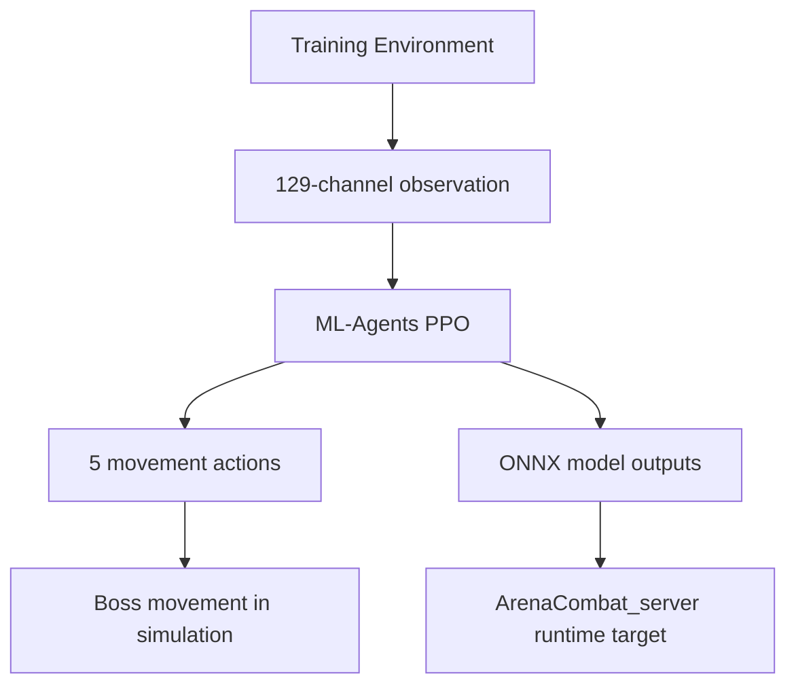

# BuildUp ML Training

> Unity ML-Agents training project for boss movement policies targeting the ArenaCombat_server runtime.

BuildUp is a supporting ML training repository for [ArenaCombat_server](https://github.com/paek678/ArenaCombat_server). It is not the main multiplayer runtime. Its role is to train and analyze boss movement policies separately, then provide ONNX model assets and documented observation/action specs that can be aligned with the ArenaCombat_server runtime.

## Highlights

- Unity ML-Agents PPO training setup for boss movement.
- 129-channel observation spec for combat-aware movement decisions.
- 5 discrete movement actions.
- matchup-based training analysis.
- ONNX model outputs and runtime alignment target.

## Tech Stack

| Area | Version / Tool |
| --- | --- |
| Engine | Unity `6000.3.11f1` |
| ML Framework | Unity ML-Agents `4.0.2` |
| Input | Unity Input System `1.19.0` |
| Rendering | URP `17.3.0` |
| Runtime Target | ArenaCombat_server host-authoritative runtime |

## Role In The Portfolio

```text
ArenaCombat_server = main multiplayer combat runtime
BuildUp = related ML training project for boss movement
```

BuildUp trains movement policies. It does not own multiplayer authority, combat resolution, or final skill execution. Those responsibilities remain in ArenaCombat_server.

## Training Structure



## Observation Spec

The portfolio-facing spec is a 129-channel observation split into six groups:

| Section | Channels |
| --- | ---: |
| Position relations | 11 |
| Boss/player state | 4 |
| Boss skill slots | 35 |
| Touch flags | 2 |
| Player skill slots | 70 |
| Extra battle context | 7 |
| Total | 129 |

This is stronger than simple position tracking because the model can observe combat context such as skill slots, casting state, movement state, and recent battle context.

## Action Spec

| Index | Action |
| ---: | --- |
| 0 | idle |
| 1 | forward |
| 2 | turn left |
| 3 | turn right |
| 4 | backward |

The model is scoped to movement decisions only. Skill selection and combat rules stay in the ArenaCombat_server runtime.

## Training Analysis

`TRAINING_ANALYSIS.md` contains a 2026-05-25 analysis over 5 matchup types and 2,585 episodes.

Example verified results:

| Matchup | Episodes | Boss Win Rate | Recent 50 Episodes | Grade |
| --- | ---: | ---: | ---: | --- |
| Hybrid x CC | 252 | 66.7% | 68.0% | S |
| Hybrid x Hybrid | 1,464 | 63.6% | 64.0% | A |
| Ranged x CC | 192 | 53.1% | 58.0% | B |
| Ranged x Hybrid | 134 | 47.0% | 54.0% | C+ |
| Ranged x Ranged | 543 | 38.3% | 58.0% | B- |

## ONNX Outputs

The repository contains ONNX outputs in multiple locations, including:

- `Assets/Scripts/AI/BossAI/`
- `onnx_9matchup/`
- `results/`

Use safe wording for public documentation:

```text
BuildUp produces ONNX model assets and documents the observation/action spec required for ArenaCombat_server runtime alignment.
```

## Documentation

- [Portfolio Overview](docs/portfolio/overview.md)
- [Observation & Action Spec](docs/portfolio/observation-action-spec.md)
- [Training Analysis](docs/portfolio/training-analysis.md)

## Current Status

This repository is a training and analysis project, not the main game runtime.

Verified from local project files:

- Unity project and package versions are present.
- Boss AI agent, observation, training, and skill folders exist.
- ONNX outputs are present.
- matchup analysis data is documented in `TRAINING_ANALYSIS.md`.

Needs separate validation before stronger claims:

- final selected production model
- exact runtime performance inside ArenaCombat_server
- final balance and behavior quality

