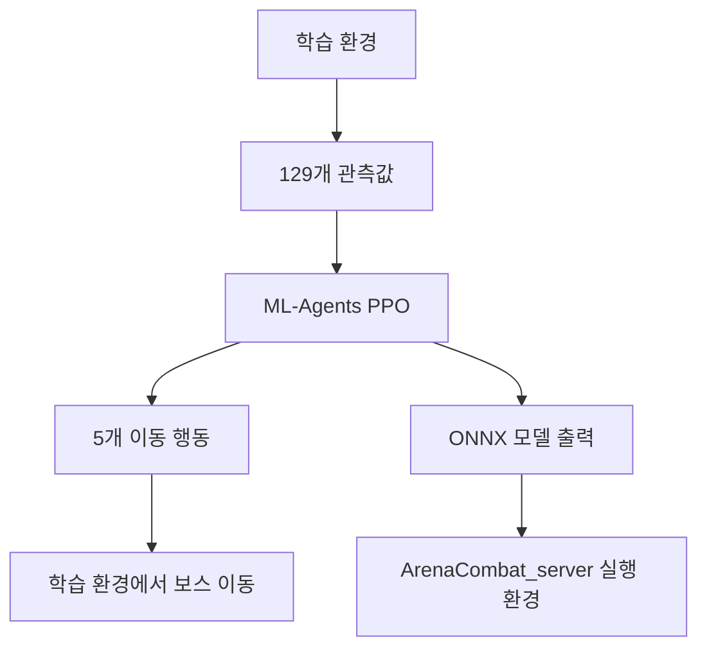

# BuildUp 보스 이동 AI 학습

> Unity ML-Agents로 보스의 이동 정책을 학습하고, ArenaCombat_server 실행 환경에 사용할 ONNX 모델을 생성하는 프로젝트입니다.

BuildUp은 [ArenaCombat_server](https://github.com/paek678/ArenaCombat_server)의 보스 이동 AI를 학습하고 분석하는 Unity 프로젝트입니다. 플레이어 봇을 상대로 이동 정책을 반복 학습하고, 학습 결과를 ONNX 모델로 출력합니다. 실제 게임의 멀티플레이 연결, 전투 판정, 스킬 실행은 ArenaCombat_server에서 담당합니다.

## 주요 기능

- Unity ML-Agents PPO를 활용한 보스 이동 정책 학습
- 전투 상황을 반영하는 129개 관측값 구성
- 5개 이산 이동 행동을 사용하는 정책 설계
- 플레이어 성향 조합별 학습 결과와 행동 패턴 분석
- ONNX 모델 출력 및 게임 실행 환경과의 연동 규격 정리

## 기술 스택

| 구분 | 버전 및 도구 |
| --- | --- |
| 게임 엔진 | Unity `6000.3.11f1` |
| 머신러닝 프레임워크 | Unity ML-Agents `4.0.2` |
| 입력 | Unity Input System `1.19.0` |
| 렌더링 | URP `17.3.0` |
| 모델 적용 대상 | ArenaCombat_server의 호스트 권한 기반 실행 환경 |

## 프로젝트 역할

| 프로젝트 | 역할 |
| --- | --- |
| BuildUp | 보스 이동 정책 학습, 실험 결과 분석, ONNX 모델 출력 |
| ArenaCombat_server | 실제 멀티플레이 게임 실행, 전투 판정, 스킬 실행, 모델 추론 |

BuildUp은 이동 정책을 학습하는 환경이며, 네트워크 권한과 최종 전투 결과는 ArenaCombat_server에서 관리합니다.

## 학습 구조

## 관측 공간

관측값은 다음 6개 영역, 총 129개 채널로 구성합니다.

| 영역 | 채널 수 |
| --- | ---: |
| 보스와 플레이어의 위치 관계 | 11 |
| 보스 및 플레이어 상태 | 4 |
| 보스 스킬 슬롯 | 35 |
| 플레이어의 근접 범위 진입 여부 | 2 |
| 플레이어 스킬 슬롯 | 70 |
| 추가 전투 정보 | 7 |
| 합계 | 129 |

위치와 거리 외에도 스킬 슬롯, 시전 상태, 이동 상태, 최근 전투 정보를 관측하여 전투 상황에 따른 이동 판단에 활용합니다.

## 행동 공간

| 인덱스 | 행동 |
| ---: | --- |
| 0 | 대기 |
| 1 | 전진 |
| 2 | 좌회전 |
| 3 | 우회전 |
| 4 | 후진 |

학습 모델은 이동 행동을 선택합니다. 스킬 선택과 발동, 전투 규칙은 별도 로직에서 처리하며, 실제 게임에서는 ArenaCombat_server가 해당 처리를 담당합니다.

## 학습 결과 분석

[TRAINING_ANALYSIS.md](TRAINING_ANALYSIS.md)에는 2026년 5월 25일 기준 5개 매치업, 총 2,585에피소드의 분석 결과가 정리되어 있습니다. 해당 분석 문서의 결과는 다음과 같습니다.

| 매치업 | 에피소드 수 | 보스 승률 | 최근 50에피소드 승률 | 분석 등급 |
| --- | ---: | ---: | ---: | --- |
| Hybrid x CC | 252 | 66.7% | 68.0% | S |
| Hybrid x Hybrid | 1,464 | 63.6% | 64.0% | A |
| Ranged x CC | 192 | 53.1% | 58.0% | B |
| Ranged x Hybrid | 134 | 47.0% | 54.0% | C+ |
| Ranged x Ranged | 543 | 38.3% | 58.0% | B- |

Hybrid는 혼합형, Ranged는 원거리형, CC는 군중제어형 플레이어를 뜻합니다.

## ONNX 모델 출력

ONNX 출력물은 다음 경로에 보관되어 있습니다.

- `Assets/Scripts/AI/BossAI/`
- `onnx_9matchup/`
- `results/`

BuildUp은 ONNX 모델과 함께 ArenaCombat_server에서 모델을 사용하기 위한 관측값 및 행동 규격을 정리합니다. 실제 적용 시 두 환경의 규격과 이동 조건이 일치하는지 확인해야 합니다.

## 관련 문서

- [프로젝트 개요](docs/portfolio/overview.md)
- [관측값과 행동 규격](docs/portfolio/observation-action-spec.md)
- [학습 결과 분석](docs/portfolio/training-analysis.md)

## 현재 구현 및 검증 범위

현재 저장소에는 다음 자료가 포함되어 있습니다.

- Unity 프로젝트 및 패키지 버전 설정
- 보스 AI 에이전트, 관측값 수집, 학습 환경 및 스킬 관련 코드
- 학습 결과 ONNX 모델
- `TRAINING_ANALYSIS.md`에 기록된 매치업별 분석 결과

추가로 확인할 항목은 다음과 같습니다.

- 실제 게임에 사용할 최종 모델 선정
- ArenaCombat_server에서 각 모델의 동작과 실행 성능
- 최종 전투 밸런스와 보스 행동 품질
